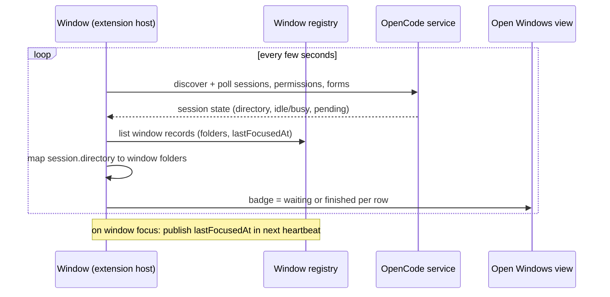

# Proposal: Open Windows indicators

## Status

Accepted

All P-01 through P-06 are accepted as of 2026-11-23. Acceptance is not
implementation; no code has changed.

## Proposed approach

Each window's extension instance polls the shared OpenCode background service
through `@opencode/client`, maps sessions to its registry of window folders by
`location.directory`, and derives two attention states per window row. A new
optional `lastFocusedAt` heartbeat field supplies the clearing baseline. The
Open Windows view renders a badge for attention and a colored icon for the
current window.

### P-01: Indicators live in the Open Windows view only

- Status: accepted
- Approach: extend the existing `WindowItem` rows with an OpenCode attention
  badge and a colored current-window marker. The Projects view and the quick
  pickers stay unchanged.
- Context and evidence: the user asked for notification in the Open Windows
  view and a colored current window (2026-11-20 session).
- Alternatives and tradeoffs: badges in the Projects tree reach more places but
  conflate saved projects with live windows; deferred as follow-up.
- Consequences: none outside `windowsView.ts` and its row model.
- Confirmation: user request, 2026-11-20.

### P-02: Detect OpenCode state via `@opencode/client`

- Status: accepted
- Approach: use `Service.discover()` from `@opencode/client/service` to find
  the registered background service, `Service.headers(endpoint)` for auth, and
  the typed client to poll session, permission, and form state. Never start
  the service. Service absent or unreachable: no badges, view unaffected.
  Polling first; the client's event subscription is a later optimization
  (live-only, no replay, so polling stays as resync).
- Context and evidence: service registration and API verified live on
  2026-11-20 (see overview sources). Client capabilities from
  https://opencode.ai/docs/build/client.
- Alternatives and tradeoffs:
  - Hand-rolled GETs with Basic auth: verified working, zero dependencies, but
    hardcodes an undocumented auth scheme and payload shapes. Rejected by the
    user in favor of the official client.
  - SQLite reads of `session_v2`: private schema, no waiting-for-input or
    busy/idle signals. Rejected.
- Consequences: the extension gains its first runtime dependency. Packaging
  must change from `vsce package --no-dependencies` (`package.json:79`) to a
  bundle or shipped `node_modules`. Bundler choice is open, slice 02.
- Confirmation: "use the client", 2026-11-23.

### P-03: Two badge states — waiting and finished

- Status: accepted
- Approach: *waiting* shows when a permission request or form is pending for a
  session mapped to the window; state-driven, clears when answered. *Finished*
  shows when a mapped session is idle with activity newer than the window's
  `lastFocusedAt` and not in the active map. Two visually distinct markers:
  orange for waiting, green for finished.
- Context and evidence: user definition, 2026-11-20 — an update means the
  session finished its work or waits for input. Endpoints verified live.
- Alternatives and tradeoffs: one combined badge is simpler but hides urgency;
  a third "running" marker is possible from `/api/session/active`, deferred.
- Consequences: mapping is per window directory, not per session; several
  sessions in one directory aggregate into one row state.
- Confirmation: semantics confirmed 2026-11-20; two markers and the
  green/orange set confirmed 2026-11-23.

### P-04: Clearing baseline via optional `lastFocusedAt` heartbeat field

- Status: accepted
- Approach: each window records `vscode.window.onDidChangeWindowState`
  focus gains and publishes `lastFocusedAt` as an optional field in its
  heartbeat record. A *finished* badge shows when session activity is newer
  than that field. Records without the field (extension 0.3.0 windows)
  suppress *finished* but still show *waiting*.
- Context and evidence: the record validator ignores extra fields
  (`src/windowRegistry.ts:55-62`), so mixed versions coexist without
  migration. Heartbeat cadence is 3s, so clearing propagates within seconds.
- Alternatives and tradeoffs: a per-viewing-window seen-map cleared on row
  click needs no protocol change but stays stale when the user focuses a
  window directly. Rejected.
- Consequences: badge correctness depends on every window running a version
  that publishes the field; mixed fleets degrade to waiting-only badges.
- Confirmation: focus-clearing confirmed 2026-11-20; field mechanism confirmed
  2026-11-23.

### P-05: Current window shown with a colored icon plus text

- Status: accepted
- Approach: `ThemeIcon` with a `ThemeColor` (for example green) on the current
  row, keeping the "· Current window" description and accessibility label.
  Color never carries the meaning alone.
- Context and evidence: `row.current` already exists (`src/windowList.ts:25`);
  `WindowItem` already sets `contextValue` `windowCurrent`
  (`src/windowsView.ts:14-15`). Render-only change.
- Alternatives and tradeoffs: a `FileDecorationProvider` could color the label
  text too, at higher complexity. Deferred unless the icon proves too subtle.
- Consequences: none on protocol or storage.
- Confirmation: confirmed 2026-11-23 (green icon, text retained).

### P-06: Two slices — color first, badges second

- Status: accepted
- Approach: slice 01 ships P-05 (render-only, zero risk). Slice 02 ships P-02
  through P-04 (client, mapping, heartbeat field, badge rendering).
- Alternatives and tradeoffs: one combined slice delays the trivial color
  change behind the badge machinery.
- Confirmation: confirmed 2026-11-23.

## Sequence flows

Scope: P-02/P-03/P-04 badge update cycle, proposed design. Sources: verified
API shapes (2026-11-20), `src/windowRegistry.ts` heartbeat. Assumes the
service is already running; discovery failure ends the cycle silently.

## Open questions and assumptions

- Global versus per-directory behavior of `/api/permission/request` and
  `/api/form` (observed location default with empty data; per-directory query
  exists as fallback; resolve during slice 02).
- ~~Bundler or shipped dependencies for `@opencode/client`~~ Resolved
  2026-11-24: esbuild bundle (user decision). `tsc` keeps emitting tests and
  typechecking; esbuild bundles `src/extension.ts` with `vscode` external;
  packaging keeps `--no-dependencies`.
- Assumption: OpenCode upgrades keep client/service compatibility; the
  client's version handling is the mitigation. Non-blocking.

## Risk findings

- R1 (sensitive data): the extension reads the service password via the
  registration file. Localhost-only traffic; never log the password or include
  it in diagnostics. Non-blocking.
- R2 (reliability): service absent, auth failure, or API drift must leave the
  tree view functional; badges fail silent. Acceptance criterion for slice 02.
- R3 (compatibility): mixed 0.3.0 and newer windows coexist; older records
  lack `lastFocusedAt` and degrade to waiting-only badges. No migration.
- R4 (accessibility): badges and current-window color pair with text and
  accessibility labels; color is never the only signal.

## Agreement and change history

| Event | Item | Confirmation and rationale | Impact |
| --- | --- | --- | --- |
| 2026-11-20 design session | P-01 | User requested badges in the Open Windows view and a colored current window. | Scope set. |
| 2026-11-20 design session | P-03 | User defined an update as "finished its thing or waiting for some input". | Badge semantics fixed; marker style open. |
| 2026-11-20 design session | P-04 | User chose clearing when the window regains focus over click-clearing and time-based fade. | Heartbeat field mechanism proposed. |
| 2026-11-23 design session | P-02 | User chose `@opencode/client` over hand-rolled HTTP and SQLite reads, for supported auth, typed payloads, and the event-stream path. | Packaging change required; slice 02 build setup. |
| 2026-11-23 design session | P-02 | Re-confirmed after reviewing the OpenAPI-based alternative: the spec documents routes and schemas but not discovery or auth (verified: empty `securitySchemes`, live 401 without Basic auth). User kept the client so it owns discovery, auth, and the event stream. | P-02 stands; hand-rolled and spec-generated variants rejected. |
| 2026-11-23 design session | P-03, P-04, P-05, P-06 | User accepted all remaining proposals: two markers (orange waiting, green finished), the `lastFocusedAt` heartbeat field, the green current-window icon with retained text, and the two-slice split. | Proposal fully accepted; slice 01 drafting unblocked. |

## Implementation evidence

Not checked. No implementation has started.
