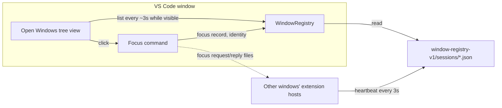

# Proposal: Open Windows view

## Status

Accepted

All six decisions below were explicitly accepted by the user in the 2026-11-15/16
session. Acceptance does not authorize implementation.

## Proposed approach

Add a second tree view, "Open Windows", to the existing Projects activity bar container.
The view reads live window records from the existing `WindowRegistry` and focuses the
selected window through the existing focus protocol. No registry changes are needed.

### P-01: Dedicated "Open Windows" tree view

- Status: accepted
- Approach: new view `projectSwitcher.windows` in the existing `projectSwitcher`
  container. Data from `WindowRegistry.list()`, filtered to records updated within 15s,
  matching the picker's staleness rule (`src/projectCommands.ts:436`).
- Context and evidence: the registry already publishes per-window records every 3s
  (`src/windowRegistry.ts:145-153`). The container already exists (`package.json:50-55`).
- Alternatives and tradeoffs: badges in the Projects tree (no persistent list of unsaved
  windows; user declined for v1); surfacing the picker only (not a persistent display).
- Consequences: one new view contribution and provider; the existing picker command stays.
- Confirmation: user selected "New sidebar view", then accepted P-01–P-06 (2026-11-15/16).

### P-02: One row per window, folders as children

- Status: accepted
- Approach: each live window is one row, labeled with its first folder's basename.
  Multi-root windows expand to one child per folder. The current window is marked
  "· Current window".
- Context and evidence: records carry a folder list (`src/windowRegistry.ts:10-16`);
  multi-root windows exist (`src/projectCommands.ts:25-32`). The registry records no
  window title, so labels derive from folder paths.
- Alternatives and tradeoffs: flat per-folder rows like the picker — simpler, but lists
  multi-root windows once per folder. The window-centric row matches the feature name.
- Consequences: same-named folders produce similar labels; the row description shows the
  full path to disambiguate.
- Confirmation: accepted with P-01–P-06 (2026-11-15/16).

### P-03: Click focuses the window

- Status: accepted
- Approach: row click runs a command that calls `registry.focus(record, identity)` with
  the window's folder identity.
- Context and evidence: the focus request/reply protocol already exists
  (`src/windowRegistry.ts:229-255`) and powers the picker (`src/projectCommands.ts:457`).
- Alternatives and tradeoffs: reusing `projectSwitcher.openWindows` would reintroduce the
  picker; a direct focus call is the existing, tested path.
- Consequences: focus failures (stale window, no response) surface through the existing
  error path. A window that dies between refresh and click fails with a clear message.
- Confirmation: accepted with P-01–P-06 (2026-11-15/16).

### P-04: Refresh every ~3s only while visible, plus on window focus

- Status: accepted
- Approach: the provider polls the registry on a ~3s timer while the view is visible,
  and refreshes on the existing window-focus hook (`src/extension.ts:59-64`).
- Context and evidence: the registry heartbeats every 3s, so faster polling adds nothing.
  The extension already polls its inbox every 250ms, so a 3s readdir of a small local
  directory fits the existing cost profile.
- Alternatives and tradeoffs: event-driven refresh (registry has no change event; would
  add machinery for no user-visible gain); unconditional timer (reads disk while hidden).
- Consequences: a closed window may linger up to ~15s (staleness window) plus one refresh
  interval before disappearing. Same delay already governs the picker.
- Confirmation: accepted with P-01–P-06 (2026-11-15/16).

### P-05: List all participating windows

- Status: accepted
- Approach: every live record appears, including windows whose folder is not a saved
  project. No saved-project matching in v1.
- Context and evidence: the registry sees every window running the extension, not only
  saved projects. User explicitly chose this scope.
- Alternatives and tradeoffs: saved-projects-only would hide unsaved-folder windows and
  couple the view to store reads and store failures.
- Consequences: the view needs no store access; store outages do not affect it.
- Confirmation: user selected "All live windows", then accepted P-01–P-06 (2026-11-15/16).

### P-06: Mirror the Projects view's empty and error states

- Status: accepted
- Approach: on registry failure, show a warning message row, matching the Projects view's
  `MessageItem` pattern (`src/projectsView.ts:56-62`). The current window always
  participates once registered, so the list is rarely empty.
- Context and evidence: `WindowRegistry.list()` throws when the registry is unhealthy
  (`src/windowRegistry.ts:196-211`).
- Alternatives and tradeoffs: a views-welcome entry suits a permanently empty view; this
  view's empty state is transient, so a message row fits better.
- Consequences: registry errors are visible in the sidebar instead of only in command
  error messages.
- Confirmation: accepted with P-01–P-06 (2026-11-15/16).

## Component view

Caption: component view of the proposed design (P-01, P-03, P-04). Registry, record
files, and the focus protocol are observed implementation (`src/windowRegistry.ts`);
the view and focus command are proposed. Sources cited in overview.md.

## Open questions and assumptions

- ~~Cross-profile registry visibility is unverified~~ **Resolved 2026-11-20** by
  [cross-profile-windows P-01](../cross-profile-windows/proposal.md#p-01-registry-root-moves-to-the-shared-home-dir-location):
  the registry moved to the shared home-dir root. Runtime verification pending.
- Same-named folders in different windows produce similar row labels; the full path in
  the row description disambiguates. Deferred.
- Two windows on the same folder appear as separate rows. Acceptable; deferred.

## Agreement and change history

| Event | Item | Confirmation and rationale | Impact |
| --- | --- | --- | --- |
| 2026-11-15/16 session | P-01–P-06 | User chose the sidebar view and all-window scope, then explicitly accepted P-01–P-06 as proposed. | Baseline for the first slice. |
| 2026-11-20 session | Close action | User requested closing windows from the extension and chose all-windows scope. | This view gains a row close action via the [close-window feature](../close-window/proposal.md); P-01–P-06 are unchanged. |

## Implementation evidence

Partially implemented (2026-11-16). Slice 01 code complete and unit-tested:
`npm run compile` clean, `npm test` 142 pass / 0 fail (6 new `windowList` tests).
Changed files: new `src/windowList.ts`, `src/windowsView.ts`, `src/test/windowList.test.ts`;
updated `src/extension.ts`, `src/projectCommands.ts`, `package.json`;
`src/windowRegistry.ts` exports its staleness constant. Runtime window behavior
(focus, rendering, visibility gating, accessibility) remains unverified; the user
accepted unit plus static verification and deferred manual runtime checks.
Pre-existing observed code: `src/windowRegistry.ts` (registry, focus),
`src/projectCommands.ts` (picker using the same data), `src/projectsView.ts` (provider pattern).
